# Daisy Blooms Salon — Website Project

## Student Information
- **Student Name:** Noluthando Zondi
- **Student Number:** ST10531705
- **Module:** WEDE5020 — Web Development (Introduction)
- **Institution:** The Independent Institute of Education (IIE Rosebank International)
- **Live website (GitHub Pages):** https://noluthandozondidev.github.io/daisy-blooms-website/
- **Repository:** https://github.com/NoluthandoZondiDev/daisy-blooms-website

## Project Overview
Daisy Blooms Salon is a hypothetical family-run neighbourhood hair and
beauty salon offering haircuts, styling, colouring, and beauty
treatments. The salon currently has no website and relies on phone
calls and WhatsApp messages for bookings, which has led to repeated
double-bookings. This project builds a six-page website to give the
salon a professional online presence and a structured way for clients
to make enquiries.

This repository documents all three parts of the project:
- **Part 1:** Building the Foundation (HTML structure and content).
- **Part 2:** CSS styling and responsive design. Scored 100% (Excellent) with no corrections required.
- **Part 3:** JavaScript functionality, SEO, and deployment on GitHub Pages.

## Website Goals and Objectives
- Reduce double-bookings by moving enquiries away from informal
  phone/WhatsApp scheduling.
- Showcase services and indicative pricing to attract new local
  clients.
- Build a professional online presence reflecting the salon's brand.
- Provide an easy way for clients to make service enquiries.

**Key Performance Indicators (KPIs):** number of monthly
enquiry-form submissions; reduction in scheduling conflicts reported
by staff; number of monthly website visits; time spent on the
Services page.

## Key Features and Functionality
- Home page with hero introduction, services preview, "Our Work" photo preview with a pop-up viewer, and a testimonial band.
- About page with salon history, mission, and team profiles.
- Services page with an expandable price list that can be searched and sorted.
- Gallery page with 16 photographs, service filters, and a pop-up viewer (lightbox).
- Enquiry page with a validated form that gives an instant price and availability response.
- Contact page with two branch locations, an interactive map, opening hours, and a message form that prepares an email.
- Custom 404 "Page Not Found" page.
- Consistent navigation menu across all six pages.
- Responsive design for desktop, tablet, and mobile, with rose-gold glow hover effects on cards, buttons, and gallery images.
- Search engine optimisation (SEO) on every page.

## Timeline and Milestones
| Milestone | Target |
|---|---|
| Planning, research, and content gathering | Week 1-2 |
| Basic HTML structure and file organisation (Part 1) | Week 3-4 |
| CSS styling and responsive design (Part 2) | Week 5-7 |
| JavaScript functionality, forms, and SEO (Part 3) | Week 8-11 |
| Final testing, deployment, and submission | Week 12 |

## Sitemap
```
Home (index.html)
├── About (about.html)
├── Services (services.html)
├── Gallery (gallery.html)
├── Enquiry (enquiry.html)
└── Contact (contact.html)
```
All six pages are linked through a shared navigation menu. `404.html` is shown automatically when a visitor opens an address that does not exist.

## Part 1 Details
Part 1 deliverables completed in this repository:
- Website Project Proposal (submitted separately as a Word/PDF
  document, covering both StudyBuddy Foundation and Daisy Blooms
  Salon proposals).
- Content research and sourcing (images sourced from free-licence
  stock photo sites; see References below).
- Sitemap (above).
- File and folder structure with HTML pages at the root and `css/`, `js/`, `images/`, and `lib/` folders.
- Basic HTML structure and content for all pages, using
  semantic tags (`header`, `nav`, `main`, `section`, `article`,
  `footer`), a working navigation menu, and code comments.

## Part 2 Details
Part 2 added the CSS styling and responsive design (external stylesheet `css/style.css`, CSS Grid and Flexbox layouts, media queries, hover effects, and accessible navigation). The responsive design evidence is shown at the bottom of this README.

**Part 2 result and feedback:** scored 100/100 (Excellent). No corrections were required. The lecturer's feedback praised the external CSS styling, responsive design, CSS Grid and Flexbox layouts, accessible navigation, and the README documentation with changelog, testing screenshots, and references.

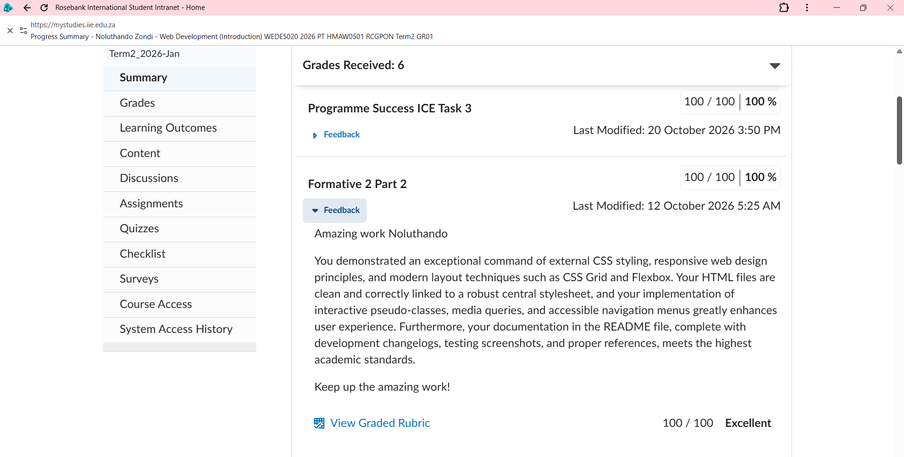

The Part 2 version of the project is saved in the repository with the tag `part2-final`.

## Part 3 Details

### What was added
| Feature | Where it is |
|---|---|
| Gallery pop-up viewer (lightbox) | `js/script.js` (section 1), used on `index.html` and `gallery.html` |
| Gallery page: 16 photos with service filters and a fade effect | `gallery.html`, `images/gallery/` |
| Services accordion, live search, price sort, and results summary | `services.html`, `js/script.js` (section 3) |
| Enquiry form: validation, dd/mm/yyyy date, time slots that change with the date, and a price/availability response | `enquiry.html`, `js/script.js` (section 4) |
| Interactive map showing both branches (Leaflet 1.9.4 with OpenStreetMap) | `contact.html`, `lib/leaflet/`, `js/script.js` (section 5a) |
| Contact form that checks the input and builds a ready-to-send email (mailto link, Gmail link, and copy button) | `contact.html`, `js/script.js` (section 5b) |
| SEO and deployment | All pages, `robots.txt`, `sitemap.xml`, `404.html`, `.nojekyll` |

### JavaScript
All JavaScript is in one file, `js/script.js`, loaded at the end of each page so the page content exists before the script runs. Each feature checks that its page elements exist first, so one script safely serves all six pages. The pages still show their content (prices, photos, forms) if JavaScript is switched off.

### Accessibility
- Form fields have visible labels, and error messages are linked to their fields.
- Accordion buttons use `aria-expanded`, and the search results line uses `aria-live` so screen readers announce changes.
- All photographs have descriptive alt text.
- The map buttons and the lightbox can be used with a keyboard.

### SEO (search engine optimisation)
- A unique `<title>`, meta description, and keywords on every page.
- A canonical link and Open Graph/Twitter tags for social sharing previews.
- JSON-LD structured data (`HairSalon`) for both branches on the home page.
- Descriptive image file names (for example `salon-interior-styling-stations-hero.jpg`) and descriptive alt text.
- Favicon (a small daisy icon shown on the browser tab).
- `robots.txt`, `sitemap.xml`, and a custom `404.html`.
- `.nojekyll` so GitHub Pages serves the site files as they are.
- Images use `srcset` so phones download smaller versions, and gallery images load lazily.
- Heading tags (`h1`, `h2`, `h3`) structure the content of every page.
- Clean, descriptive page addresses (for example `services.html` and `gallery.html`).
- Internal linking: the navigation menu is on every page, and the home page links to the price list, the gallery, and the enquiry form.
- Mobile-friendliness: a viewport meta tag and the responsive layout from Part 2.

**Page speed:** photographs are compressed and provided in small, medium, and large sizes; gallery images load lazily; Leaflet is stored locally in `lib/leaflet/` instead of being loaded from another website; and the Google Fonts connections are opened early with `preconnect`.

**Security:** GitHub Pages serves the site over HTTPS (Enforce HTTPS is switched on). A referrer policy meta tag limits what is shared when visitors click away, form fields have length limits, and no form data is sent to or stored by a server.

**Off-page and local SEO (plan only):** because Daisy Blooms Salon is a hypothetical business, no real backlinks or social media promotion were done. For a real salon the plan would be a Google Business Profile for each branch, local directory listings, links from supplier and partner websites, and regular social media posts that link back to the site. The structured data for both branches already supports local search.

### Deployment
The site is deployed with GitHub Pages (Settings > Pages > Deploy from branch `main`, folder `/ (root)`) at:
https://noluthandozondidev.github.io/daisy-blooms-website/

Every page was opened and tested on the live link. The website files are in the repository root, as GitHub Pages requires.

### Libraries used
- Leaflet 1.9.4 (Agafonkin, 2023), stored locally in `lib/leaflet/`.
- Map tiles and data from OpenStreetMap (OpenStreetMap contributors, n.d.).
- Fonts: Playfair Display and Montserrat from Google Fonts.

### Limitations and notes
- There is no server, so the enquiry response and the contact email are built in the visitor's browser. Nothing is sent or stored by the website. The visitor sends the prepared email from their own email app or Gmail.
- Service durations, patch-test tips, prices, and the JSON-LD details are demonstration data for a hypothetical business.
- The map pins are approximate positions for the two hypothetical branches.
- Testing was done in Microsoft Edge on Windows, using the browser Console to check for errors.

### Part 3 screenshots
**Gallery with filters and lightbox**
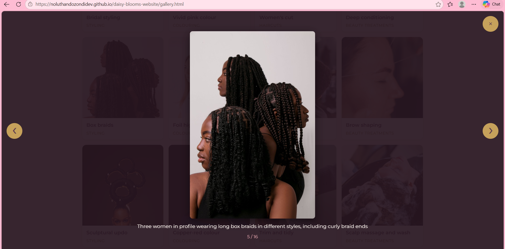

**Services accordion, search, and sort**
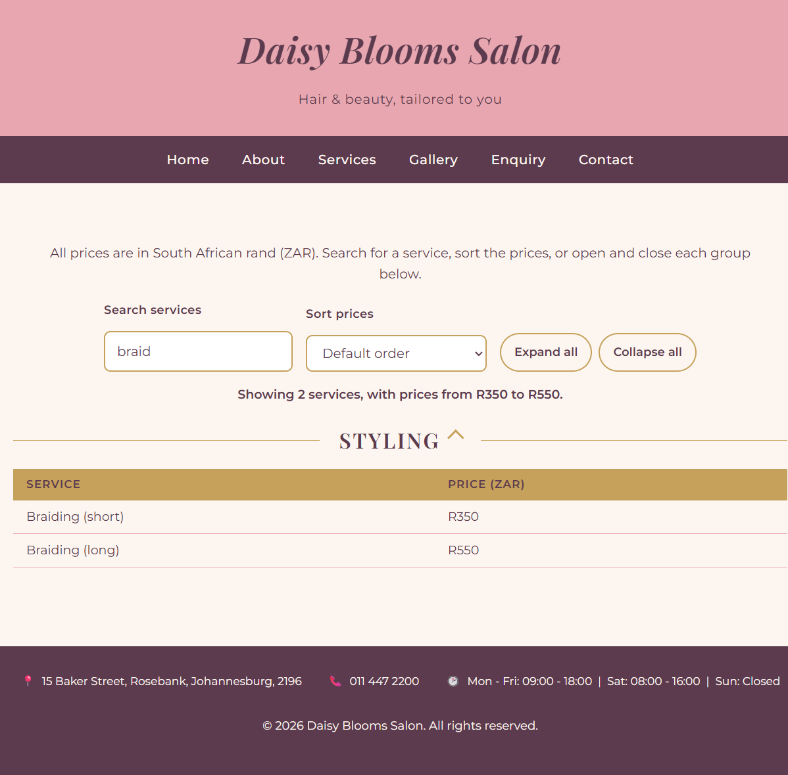

**Enquiry form response**
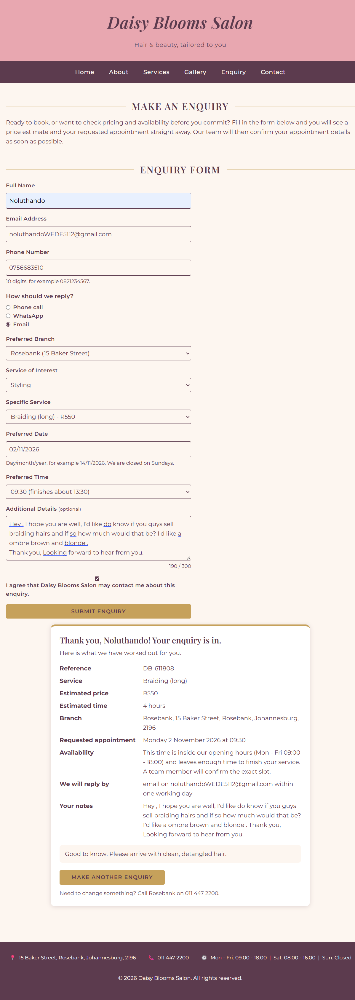

**Interactive map**
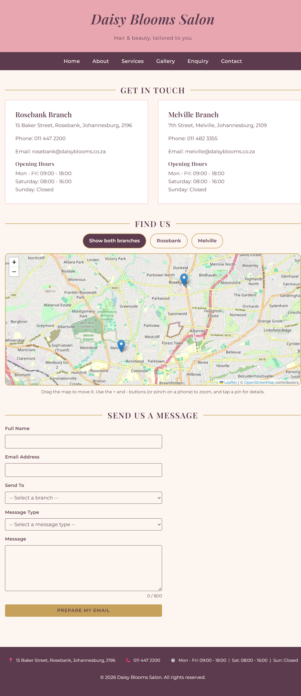

**Live site on GitHub Pages**
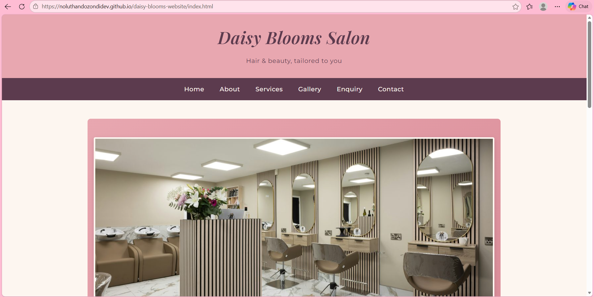

## Changelog
| Date | Change |
|---|---|
| 2026-09-10 | Replaced placeholder text on all five pages with real content: hero section, services preview, and gallery preview on index.html; salon history, mission, and team bios (with photos) on about.html; four pricing tables on services.html; full enquiry form on enquiry.html; two branch details, two embedded maps, and a general contact form on contact.html. |
| 2026-09-10 | Expanded salon scope: reassigned team specialties to Hairstylist (Daisy), Makeup Artist (Thandi), and Nail Technician (Naledi); added Makeup and Nails pricing tables to services.html; updated the services preview on index.html to reflect all six service categories. |
| 2026-09-10 | Reverted the above scope expansion after checking against the approved Part 1 proposal, which specifies haircuts, styling, colouring, and general beauty services only. Team roles, services preview, and pricing tables restored to the original four categories to stay consistent with the approved proposal. |
| 2026-09-10 | Added the testimonial band to index.html (rose-gold background, plum text) and icon+text contact details (address, phone, opening hours) to the footer on all five pages, per the Design and User Experience section of the approved Part 1 proposal. |
| 2026-09-23 | Initial commit: basic file/folder structure created (index, about, services, enquiry, contact + css/js/images folders). |
| 2026-09-23 | Added README.md with project overview, goals, sitemap, and references. |
| 2026-09-23 | Part 2 commit: created the external stylesheet `css/style.css` and linked it to every page; applied typography, colour, and layout styling with CSS Grid and Flexbox; added hover, focus, and active styles; added media queries for tablet and mobile (layout, font sizes, and navigation); added responsive images with `srcset` and `sizes`; and updated the README. |
| 2026-09-24 | Added the responsive design screenshots (desktop, tablet, and mobile views) to the README. |
| 2026-09-24 | Added the AI disclosure annexure to the README. |
| 2026-09-24 | Moved the screenshots folder so the images display correctly in the README. |
| 2026-09-24 | Adjusted photo cropping on the About page (team photos) and Home page (gallery preview) so heads are framed properly instead of cut off. |
| 2026-10-12 | Reviewed the Part 2 marks and feedback: scored 100/100 (Excellent), with no corrections or changes requested, so no edits to the Part 2 work were needed. The feedback praised the external CSS styling, responsive design, CSS Grid and Flexbox layouts, accessible navigation, and the README documentation. The Part 2 layout is kept in the `part2-final` tag. |
| 2026-10-26 | Moved the website files from the inner folder to the repository root so GitHub Pages can serve them. The tag `part2-final` keeps the Part 2 layout. |
| 2026-10-28 | Added 16 compressed Pexels photos (`images/gallery/`), the new `gallery.html` page with service filters and lightbox, a Gallery link in the menu, and an "Our Work" lightbox and link on the home page. |
| 2026-10-28 | Added the services accordion, live search, price sort, and results summary on `services.html`. |
| 2026-10-29 | Added enquiry form validation, dd/mm/yyyy date, dynamic time slots, and an instant price and availability response. |
| 2026-10-29 | Added the contact form (builds an email) and the interactive Leaflet map. Leaflet is stored locally in `lib/leaflet/`. Removed the old Google Maps iframes. |
| 2026-10-30 | Added SEO: unique titles, descriptions, keywords, canonical links, Open Graph tags, JSON-LD, favicon, descriptive image names, `robots.txt`, `sitemap.xml`, `404.html`, and `.nojekyll`. Merged the two Part 3 stylesheets into `css/enhancements.css`. |
| 2026-10-30 | Tried a logo image in the header, then removed it and restored the original text heading. Added a small CSS rule to restore the heading and tagline spacing. |
| 2026-10-30 | Deployed the site with GitHub Pages and tested every page on the live link. Updated this README with the Part 3 details, references, and AI disclosure.
| 2026-10-31 | Updated this README with the Part 3 details, screenshots, changelog, full reference list, and AI disclosure. |

## References
- Admar Kamosso Oficial, n.d. Mulhere negra. [online] Pexels. Available at: https://www.pexels.com/photo/mulhere-negra-27987128/ [Accessed 27 October 2026].
- Agafonkin, V., 2023. Leaflet: an open-source JavaScript library for interactive maps (version 1.9.4). [software] Available at: https://leafletjs.com [Accessed 29 October 2026].
- Alexander Mass, n.d. Hair stylist preparing bride in salon. [online] Pexels. Available at: https://www.pexels.com/photo/hair-stylist-preparing-bride-in-salon-33461102/ [Accessed 27 October 2026].
- Anthropic, 2026. Claude Sonnet 5.5 [large language model]. Available at: https://claude.ai [Accessed 30 October 2026].
- Beyzanur K., n.d. Close up of red hair being cut and styled. [online] Pexels. Available at: https://www.pexels.com/photo/close-up-of-red-hair-being-cut-and-styled-28994396/ [Accessed 27 October 2026].
- cottonbro studio, n.d. Woman getting her hair shampoo. [online] Pexels. Available at: https://www.pexels.com/photo/woman-getting-her-hair-shampoo-3993444/ [Accessed 27 October 2026].
- Daniel Tobby, n.d. Elegant bridal portrait of a woman in Abuja. [online] Pexels. Available at: https://www.pexels.com/photo/elegant-bridal-portrait-of-a-woman-in-abuja-31263214/ [Accessed 27 October 2026].
- Doğan Alpaslan Demir, n.d. Professional hair coloring session in salon. [online] Pexels. Available at: https://www.pexels.com/photo/professional-hair-coloring-session-in-salon-29555677/ [Accessed 27 October 2026].
- Farhad Ibrahimzade, n.d. Young beautiful woman having her hair cut at the hairdresser scissors cut the girls hair. [online] Pexels. Available at: https://www.pexels.com/photo/young-beautiful-woman-having-her-hair-cut-at-the-hairdresser-scissors-cut-the-girls-hair-19239103/ [Accessed 27 October 2026].
- Fast Incorporated, 2026. A woman with long braids looking over her shoulder. [online] Unsplash. Available at: https://unsplash.com/photos/a-woman-with-long-braids-looking-over-her-shoulder-0OOaj5fsE-s [Accessed 21 August 2026].
- Judah, P., 2025. Woman with styled hair sitting in a chair. [online] Unsplash. Available at: https://unsplash.com/photos/woman-with-styled-hair-sitting-in-a-chair-TVsgoX6rUfw [Accessed 21 August 2026].
- Kampus Production, n.d. Elderly woman using phone while having haircut. [online] Pexels. Available at: https://www.pexels.com/photo/elderly-woman-using-phone-while-having-haircut-8834086/ [Accessed 27 October 2026].
- krAzyworld\_wide, n.d. Blaq. [online] Pexels. Available at: https://www.pexels.com/photo/blaq-27821969/ [Accessed 27 October 2026].
- Matilda Jacob, n.d. Back view of two women with braided hairstyles in Abuja. [online] Pexels. Available at: https://www.pexels.com/photo/back-view-of-two-women-with-braided-hairstyles-in-abuja-37115258/ [Accessed 27 October 2026].
- Nataliya Vaitkevich, n.d.a. A side view of a woman having a threading procedure. [online] Pexels. Available at: https://www.pexels.com/photo/a-side-view-of-a-woman-having-a-threading-procedure-8558244/ [Accessed 27 October 2026].
- Nataliya Vaitkevich, n.d.b. A woman having her hair dyed. [online] Pexels. Available at: https://www.pexels.com/photo/a-woman-having-her-hair-dyed-8468038/ [Accessed 27 October 2026].
- Olukoya Isreal Ayomikun, n.d. Elegant portrait of woman with artistic hairstyle. [online] Pexels. Available at: https://www.pexels.com/photo/elegant-portrait-of-woman-with-artistic-hairstyle-36445094/ [Accessed 27 October 2026].
- OpenStreetMap contributors, n.d. OpenStreetMap. [online] Available at: https://www.openstreetmap.org [Accessed 29 October 2026].
- Pexels User, n.d. Profile portrait of woman with pink hair. [online] Pexels. Available at: https://www.pexels.com/photo/profile-portrait-of-woman-with-pink-hair-36538040/ [Accessed 27 October 2026].
- RDNE Stock project, n.d. Man in barber shop. [online] Pexels. Available at: https://www.pexels.com/photo/man-in-barber-shop-7697383/ [Accessed 27 October 2026].
- Renter, R., 2022. A person with colorful hair. [online] Unsplash. Available at: https://unsplash.com/photos/a-person-with-colorful-hair-W-cadSULH3Q [Accessed 21 August 2026].
- Tile Merchant Ireland, 2024. A room with a bunch of chairs and mirrors. [online] Unsplash. Available at: https://unsplash.com/photos/a-room-with-a-bunch-of-chairs-and-mirrors-g2u8gq5XcwE [Accessed 21 August 2026].
- Wayne Fotografias, n.d. Washing woman hair at hairdresser. [online] Pexels. Available at: https://www.pexels.com/photo/washing-woman-hair-at-hairdresser-11360227/ [Accessed 27 October 2026].

**Notes on the images:**
- The four photographs on the home page (the hero banner and the three "Our Work" photos) are from Unsplash: Tile Merchant Ireland (2024), Judah (2025), Renter (2022), and Fast Incorporated (2026).
- The 16 gallery photographs on `gallery.html` are from Pexels: Admar Kamosso Oficial (n.d.), Alexander Mass (n.d.), Beyzanur K. (n.d.), cottonbro studio (n.d.), Daniel Tobby (n.d.), Doğan Alpaslan Demir (n.d.), Farhad Ibrahimzade (n.d.), Kampus Production (n.d.), krAzyworld\_wide (n.d.), Matilda Jacob (n.d.), Nataliya Vaitkevich (n.d.a; n.d.b), Olukoya Isreal Ayomikun (n.d.), Pexels User (n.d.), RDNE Stock project (n.d.), and Wayne Fotografias (n.d.). The photos are filtered as follows: 5 Styling, 4 Colouring, 4 Haircuts, and 3 Beauty Treatments. The alt text for each photo is in `gallery.html`.
- The three team photos on the About page (`daisy-nkosi-owner-senior-stylist.jpg`, `thandi-colour-specialist.jpg`, and `naledi-stylist-beauty-therapist.jpg`) are original personal photographs and are not sourced from the internet, so they do not require a citation.

## Responsive Design Evidence

### Home Page
**Desktop (1280px)**
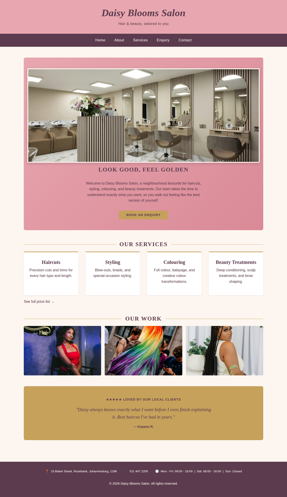

**Tablet (800px)**
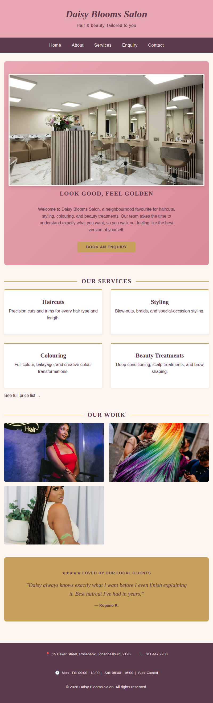

**Mobile (375px)**
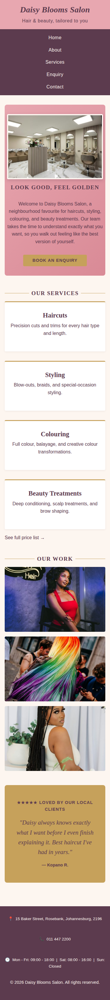

### Other Pages (Desktop view)
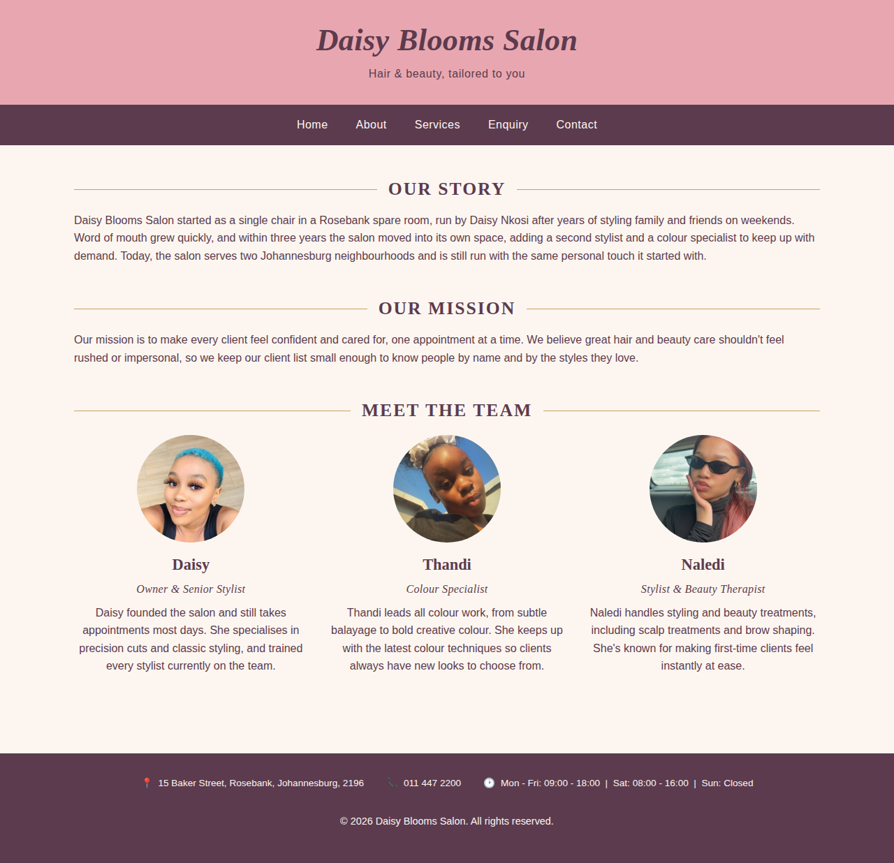
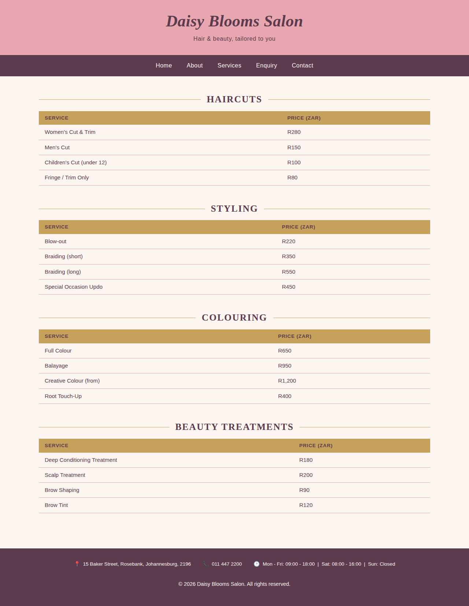
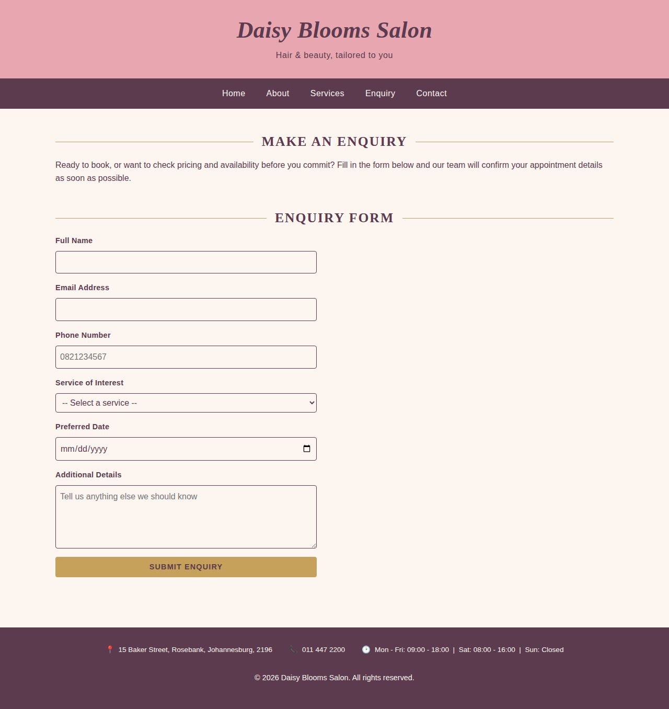
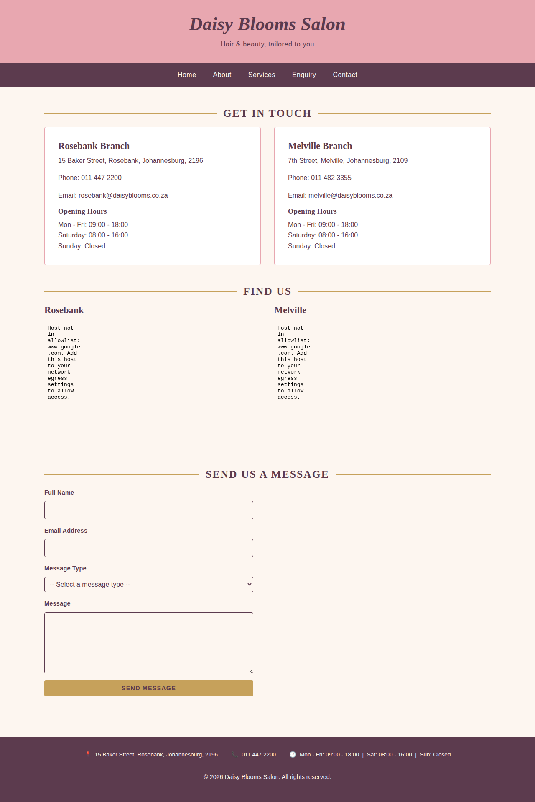

## AI Disclosure Annexure

### Part 2
AI tool used: ChatGPT
Purpose of use: Assistance with correcting the errors in the code, layout (Grid/Flexbox), and troubleshooting during Part 2.
Extent of use: AI-generated layout suggestions were reviewed and tested. All final styling decisions were made by the student, who takes full ownership of the final submitted content.

Student declaration: I confirm that I have reviewed all AI-assisted content
in this submission, understand it fully, and can explain and defend every
design decision reflected in this project.

Student name: Noluthando Zondi
Student number: ST10531705
Date: 24/09/2026

### Part 3
AI tool used:Duck.ai 

Step-by-step guidance for moving the project files, committing to GitHub, and deploying with GitHub Pages.

Extent of use: Help with how to structure some files and not duplicate, understand what `404.html` and plan out how to handling the work load in a sitemap for a couple of days. understand the `robots.txt` tested in  the webite the browser (including the Console for errors), and tested again on the live GitHub Pages site. The student made the final design decisions and work that put together the POE. The student takes full ownership of the final submitted content.

Student declaration: I confirm that I have reviewed and compared all AI-assisted ideas and help with writting things in a formal manner
in this submission, understand it fully, and can explain and defend every
design decision reflected in this project.

Student name: Noluthando Zondi
Student number: ST10531705
Date: 31/10/2026
